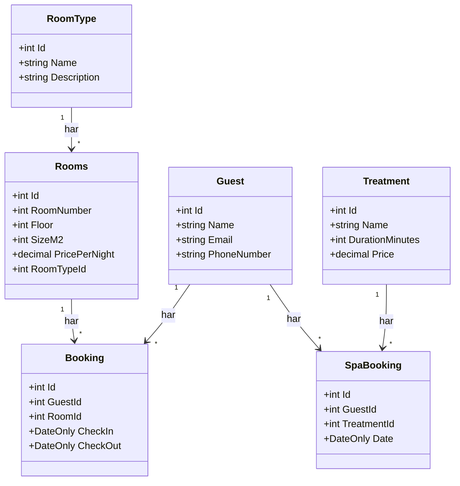

# Hotel Grandioso

Hotel Grandioso är ett bokningssystem, byggt som en konsolapp. Programmet låter personalen boka rum, avboka, se alla rum, se alla bokningar, söka efter lediga rum och boka spabehandlingar.
## Teknik

- C# konsolapp
- Entity Framework Core, Code First med migrationer
- SQLite
- LINQ för alla databasfrågor (inga råa SQL-strängar)

## Funktioner

- **Boka rum:** gästnamn, incheckning, utcheckning och rumsnummer. Gästens e-post och telefonnummer kan fyllas i, men är valfria. Totalpriset räknas ut som antal nätter × pris per natt.
- **Visa alla rum:** rumsnummer, typ, storlek och pris per natt.
- **Visa bokningar:** alla bokningar med gäst, rum, datum, antal nätter och totalpris.
- **Avboka:** en bokning tas bort via sitt id.
- **Spärr mot dubbelbokning:** ett rum kan inte bokas om det redan är bokat under överlappande datum.
- **Sök efter lediga rum:** välj ett datumintervall och se vilka rum som inte har någon överlappande bokning.
- **Boka spabehandling:** välj en behandling och ett datum. Spabokningen kopplas till gästen.

## Köra projektet

### Det som behövs

- .NET SDK. Projektet är byggt för **.NET 11** (`net11.0`, se `HotelGrandioso.csproj`).

### Steg

1. Klona repot och gå in i projektmappen:
   ```
   git clone https://github.com/Oliver-agg/HotelGrandioso.git
   cd HotelGrandioso
   ```
2. Starta programmet:
   ```
   dotnet run
   ```

Databasen behöver inte skapas för hand. När programmet startar körs migrationerna automatiskt (`Database.Migrate()` i `Program.cs`), och därefter läggs de 15 rummen, de tre rumstyperna och de fyra spabehandlingarna in (`SeedData`). Databasfilen `hotel.db` skapas i den mapp programmet körs från. Startdata läggs bara in första gången, så rummen dubbleras inte när programmet startas igen.

## Arkitektur

Koden är uppdelad i klasser där varje klass har ett tydligt ansvar:

| Klass | Ansvar |
|---|---|
| `Program.cs` | Startar programmet: skapar databasen, lägger in startdata och startar menyn. |
| `HotelMenu` | Allt som skrivs ut och läses in i konsolen: menyn, frågor, felmeddelanden och kontroll av inmatning. |
| `HotelRepository` | Allt databasarbete: hämta rum och bokningar, spara bokningar, avboka, räkna ut totalpris, hitta lediga rum och boka spabehandlingar. Kontrollerar också att ett rum är ledigt innan en bokning sparas (spärr mot dubbelbokning). |
| `HotelContext` | EF Core-kontexten. Den berättar vilka klasser som blir tabeller och var databasen ligger. |
| `SeedData` | Lägger in hotellets 15 rum, rumstyperna och spabehandlingarna. |
| `Models` (`Rooms`, `RoomType`, `Guest`, `Booking`, `Treatment`, `SpaBooking`) | Entiteterna som blir tabeller i databasen. |


### Repository: vad det gör och varför

`HotelRepository` är klassen som sköter allt som har med databasen att göra. Menyn ber den om saker, till exempel "ge mig alla rum" eller "spara den här bokningen", men menyn pratar aldrig själv med databasen.

Jag har gjort så av tre skäl:

1. **Databaskoden finns på ett ställe.** Vill jag ändra hur något hämtas eller sparas ändrar jag det bara där.
2. **Menyn blir enkel.** Den frågar användaren och skriver ut, men behöver inte veta något om EF Core eller LINQ.
3. **Det är lättare att förklara och testa.** Jag kan visa exakt var till exempel `Include` används och varför.

## Dubbelbokning

Innan en bokning sparas kontrollerar programmet att rummet är ledigt. Två bokningar krockar om båda dessa stämmer:

- den befintliga bokningen börjar före den nya slutar, och
- den befintliga bokningen slutar efter den nya börjar.

Jag använder `<` och inte `<=`, eftersom utcheckningsdagen inte är en upptagen natt. Då kan en gäst checka in samma dag som en annan checkar ut. Kontrollen görs i `HotelRepository` med `Any(...)` i LINQ, som EF Core översätter till en SQL-fråga (`EXISTS`). Den sitter i metoden som sparar bokningen, så den går inte att kringgå från menyn.

Samma regel används när programmet söker efter lediga rum: ett rum är ledigt om det inte finns någon bokning på det som överlappar perioden. Sökningen görs i `HotelRepository`, och menyn visar bara resultatet.

## UML-klassdiagram



En rumstyp har många rum, och ett rum har många bokningar över tid. En gäst kan ha många bokningar. `Booking` kopplar ihop en gäst med ett rum under en period. Priset ligger på `Rooms` och inte på `RoomType`, eftersom rum av typen Standard har olika pris (800, 1 000 och 1 200 kr). `SpaBooking` fungerar som `Booking` men kopplar ihop en gäst med en behandling (`Treatment`) ett visst datum. En gäst kan ha många spabokningar, och en behandling kan bokas många gånger.

## GDPR

Hotellchefens önskelista för `Guest` innehöll namn, hårfärg, längd och religion. Jag har kikat på listan. Det finns ingen anledning för ett hotell att samla in information om en persons hårfärg, religion eller längd. Man ska endast samla in information som direkt kopplas till och behövs för den verksamhet man bedriver, och all annan information är onödig. Det här kallas uppgiftsminimering.

- **Name: behålls.** Namnet behövs för att veta vem bokningen gäller.
- **HairColor: tas bort.** Ett bokningssystem fungerar lika bra utan den. Fältet har inget syfte kopplat till verksamheten, så att samla in det bryter mot uppgiftsminimering.
- **HeightCm: tas bort.** Samma resonemang som för hårfärg.
- **Religion: tas bort.** Religiös övertygelse är en särskild kategori av personuppgifter (artikel 9), som i regel inte får behandlas alls. Hotellet har inget skäl att spara den.
- **Email och PhoneNumber: tillagda som valfria.** Jag har lagt till dem eftersom hotellet kan behöva nå gästen, till exempel för en bokningsbekräftelse. De är valfria eftersom personalen bör fråga gästen vid bokning, men det är inget vi kräver av gästen. Om gästen inte vill lämna dem sparas ingenting (`null`).

Databasfilen `hotel.db` innehåller personuppgifter och ligger därför i `.gitignore`, så att den inte hamnar i repot.

## Antaganden och avgränsningar

- Två bokningar med samma gästnamn använder samma gäst. Två olika personer med samma namn slås därför ihop.
- En befintlig gäst uppdateras inte med nya kontaktuppgifter. De sparas bara när gästen skapas första gången.
- Avbokning tar bort bokningen men inte gästen.
- Visa bokningar visar alla bokningar, även de som redan har passerat.
- Klassen för rum heter `Rooms`, och rumstypen heter `Standard`, `Luxury` eller `Bridal` i databasen.
- Datum anges som `YYYY-MM-DD`. Utcheckningen måste ligga efter incheckningen.
- En spabokning kräver ingen rumsbokning, och spat har ingen spärr mot att samma behandling bokas flera gånger samma dag. Uppgiften kräver ingen kapacitetskontroll för spat.
- Spabokningen sparar bara datum, inte klockslag.
- Uppgiften anger bara tiden för massage (60 minuter). Entré är "per timme" och har därför 60 minuter. Tiderna för pedikyr (30 och 60 minuter) är mina antaganden.
- En gäst som bara bokar spa skapas utan kontaktuppgifter.